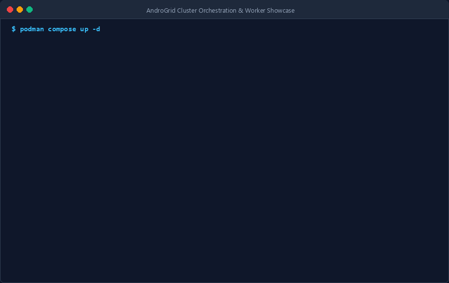

<p align="center">
  
</p>

# AndroGrid Control Plane

[](https://opensource.org/licenses/MIT)
[](https://www.rust-lang.org)
[](https://tokio.rs)
[](https://github.com/hyperium/tonic)
[](https://github.com/rustls/rustls)

<p align="center">
  
</p>

The high-concurrency Rust control plane and task orchestrator for **AndroGrid**: a distributed edge-compute cluster that harnesses heterogeneous Android devices as worker compute nodes across local Wi-Fi and metered Cellular WAN connections.

---

## Ecosystem Architecture & Overview

AndroGrid connects three foundational pillars to transform idle consumer mobile hardware into a resilient, private edge-compute cluster:

1. **Host Control Plane (`androgrid-backend`):** High-concurrency task orchestrator coordinating monotonic fencing, dual assignment, and content-addressed bytecode delivery.
2. **Mobile Worker Client (`androgrid-android`):** Native Android worker service running sandboxed WASI workloads via Chicory and Wasmtime with zero-keepalive cellular lifecycle.
3. **System Architecture Specification (`AG-SPEC-2026-V2`):** ISO/IEC/IEEE 29148 requirements traceability matrix defining all state machines, protocol contracts, and security boundaries.

For comprehensive architectural walkthroughs, visit the [Ecosystem Overview](docs/src/showcase/ecosystem.md).

---

## Mobile Cluster Economics & Hardware Feasibility FAQ

Deploying cluster compute onto smartphones often raises valid concerns regarding hardware longevity and thermal impact:

- **Battery Longevity (80% Charge Limit):** Android 14+ battery protection limits maximum charge to 80%, reducing cathode voltage stress and preventing electrolyte decomposition. Tasks are rejected below 20% battery (`[REQ-OP-003]`).
- **Thermal Hysteresis Protection:** `ThermalSafetyGuard` cuts off computation if battery temperature exceeds 38 C or the OS reports `THERMAL_STATUS_SEVERE`. Computation resumes only after cooling to 35 C, eliminating start-stop thermal flapping.
- **Superior Efficiency vs Raspberry Pi / x86:** ARM big.LITTLE mobile chips consume 15 mW to 50 mW in radio sleep, whereas a Raspberry Pi 4 consumes 2.5 W to 4.0 W continuously idling. Under cellular operation, sockets terminate within 200 ms (`[NFR-POW-001]`), permitting immediate baseband RRC low-power sleep.
- **Zero Hardware Cost:** Transforms millions of unused drawer smartphones into private edge compute nodes with built-in battery backup (UPS), Wi-Fi 6, and hardware cryptographic accelerators.
- **Zero Inbound Ports (`[INV-001]`):** Worker devices never expose listening ports. All connections originate outbound over mutual TLS 1.3 (`[INV-002]`).

Read the complete empirical analysis in the [Mobile Economics & Battery FAQ](docs/src/showcase/economics_faq.md).

---

## Architecture Overview

The Host Control Plane coordinates task scheduling, speculative dual-assignment, monotonic fencing, and result consensus:

- **Monotonic Attempt Fencing (`[INV-004]`):** Every dispatched task carries a monotonically increasing `run_attempt`. Submissions with stale attempt counters are atomically discarded with `TASK_ATTEMPT_STALE`, eliminating double-commit races.
- **Cellular Spot Preemption (`[INV-005]`):** Cellular tasks operate as speculative spot instances capped at 180 seconds. If an unmetered Wi-Fi worker connects, the task is dual-assigned with `run_attempt + 1`. The first node to commit wins.
- **Zero Inbound Mobile Ports (`[INV-001]`):** Mobile workers never bind or listen on server sockets. All network connections originate outbound from the worker nodes to the control plane.
- **Mutual TLS 1.3 (`[INV-002]`):** Full bidirectional cryptographic identity verification across all network interfaces using internal X.509 certificates.
- **Dual Transport Routing:** Supports persistent HTTP/2 declarative synchronization over local LAN and disconnected, zero-keepalive unary gRPC requests over Cloudflare Anycast ingress on cellular connections.

---

## Canonical gRPC Service Interface

The service definition (`androgrid.v1.AndroGridService`) provides two distinct interaction surfaces:

### 1. Wi-Fi Persistent Declarative Surface
- `RegisterNode`: Validates hardware capabilities and issues session tokens.
- `SyncNodeState`: Periodic 2.0-second state synchronization for active and completed tasks.

### 2. Cellular Disconnected Unary Surface (Zero-Keepalive)
- `ClaimCellularTask`: Unary task lease request (enforcing low-power RRC radio sleep).
- `SubmitCellularResult`: Atomic task result submission with attempt fencing.

### 3. Content-Addressed Artifact Distribution Engine
- `/artifacts/<sha256>.wasm`: Embedded HTTP static server serving cached WebAssembly bytecode modules.
- Sub-4KB Control Plane: Large WASM binaries are decoupled from unary gRPC payloads, preserving the 200 ms cellular radio sleep mandate (`[NFR-POW-001]`).
- Cryptographic Verification: Worker nodes verify SHA-256 hashes before executing bytecode in memory.

---

## Developer Toolchain & CLI Packaging

### Packaging Workloads (`androgrid-cli pack`)
Validate WebAssembly modules for WASI Preview 1 compatibility and generate deployment manifests:
```bash
androgrid-cli pack \
  --wasm ./workloads/wasi-starter/target/wasm32-wasip1/release/wasi_starter.wasm \
  --entrypoint _start \
  --output manifest.json
```

### Submitting Workloads (`androgrid-cli submit`)
Submit WebAssembly tasks directly to the orchestrator:
```bash
androgrid-cli submit \
  --wasm ./app.wasm \
  --timeout 60
```
The CLI automatically uploads the artifact to the orchestrator content-addressed storage, sets `artifact_sha256` and `artifact_url`, and dispatches sub-kilobyte gRPC control plane messages.

### Developer Starter Workload
See [workloads/wasi-starter](workloads/wasi-starter/README.md) for a complete starter project targeting `wasm32-wasip1`.

---

## Getting Started

### Prerequisites
- **Rust Toolchain:** Version 1.82 or newer (`rustup default stable`)
- **Protocol Buffers Compiler:** `protoc` 3.25+ or `buf` CLI

### Building from Source
```bash
# Clone the repository
git clone https://github.com/MrQuality/androgrid-backend.git
cd androgrid-backend

# Build release binary
cargo build --release

# Run unit and integration tests
cargo test
```

---

## Project Structure

```text
androgrid-backend/
├── proto/              # Canonical Protocol Buffer contracts
│   └── androgrid/v1/
│       └── orchestrator.proto
├── src/                # Control plane source code
│   ├── main.rs         # Application entry point
│   ├── artifact/       # Content-addressed storage & HTTP distribution server
│   ├── scheduler/      # Dual-assignment & monotonic fencing logic
│   ├── transport/      # Tonic gRPC services & TLS configuration
│   └── bin/            # Operator & developer CLI binaries
├── workloads/          # Canonical developer starter workloads
│   └── wasi-starter/   # wasm32-wasip1 starter project
├── tests/              # Acceptance and concurrency test suites
├── build.rs            # Tonic proto compilation build script
└── Cargo.toml          # Rust crate configuration
```

---

## Community and Governance

We welcome contributions to AndroGrid! Please review our community guidelines:

- [CONTRIBUTING.md](CONTRIBUTING.md): Workflow guidelines, branch discipline, and testing mandates.
- [CODE_OF_CONDUCT.md](CODE_OF_CONDUCT.md): Contributor Covenant v2.1 standards.
- [SECURITY.md](SECURITY.md): Responsible disclosure policy for security vulnerabilities.

---

## License

This project is licensed under the [MIT License](LICENSE).
