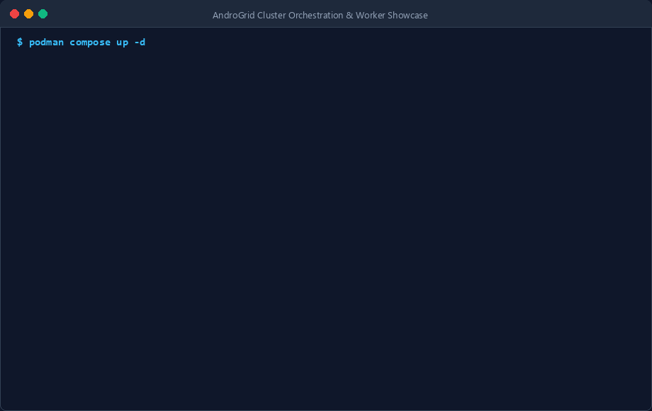

# AndroGrid Technical Documentation Portal

  

Welcome to the official technical documentation for **AndroGrid**: a high-concurrency, distributed mobile edge-computing cluster that coordinates Android worker devices across local Wi-Fi and metered Cellular WAN connections.

This documentation portal provides an authoritative, searchable reference for system architects, backend operators, and client engineers.

---

## Architectural Scope and Mission

AndroGrid harnesses idle compute capacity across heterogeneous Android mobile devices while strictly upholding battery longevity, radio resource efficiency, and hardware security boundaries.

### Core System Invariants

Every subsystem in the AndroGrid platform strictly enforces the following normative invariants defined in `AG-SPEC-2026-V2`:

- **[INV-001] Zero Inbound Mobile Ports:** Worker nodes never bind, listen on, or expose inbound TCP or UDP ports. All network traffic originates outbound from mobile devices toward the control plane.
- **[INV-002] Mutual TLS 1.3:** All control plane communications across both LAN and WAN transports strictly enforce mutual authentication (mTLS) with internal ECDSA P-256 certificates.
- **[INV-003] Zero Cellular Keepalive & Radio Sleep:** On cellular WAN interfaces, persistent TCP connections, HTTP/2 streaming, and ping heartbeats are strictly prohibited. Sockets terminate within 200 ms of task claim receipt to permit baseband Radio Resource Control (RRC) low-power sleep.
- **[INV-004] Monotonic Attempt Fencing:** All tasks carry a monotonically increasing `run_attempt` counter. Stale results are atomically discarded via Compare-And-Swap (CAS) state updates (`TASK_ATTEMPT_STALE`).
- **[INV-005] Cellular Spot Preemption & Dual-Assignment:** Cellular executions operate as speculative spot instances capped at 180 seconds. Tasks may be speculatively dual-assigned to newly joined unmetered Wi-Fi workers. The first valid result commits the task.
- **[INV-006] Sandbox Isolation Boundary:** Unrooted devices execute compute payloads strictly within the in-process WebAssembly/WASI sandbox. Unrooted devices are never assigned root shell tasks.

---

## ISO/IEC/IEEE 29148 Requirements Traceability

The AndroGrid codebase maintains strict bidirectional traceability to ISO/IEC/IEEE 29148 standards:

| Requirement ID | Classification | Architectural Scope |
| :--- | :--- | :--- |
| `[REQ-OP-001]` | Functional | Node registration and capability negotiation over Wi-Fi LAN |
| `[REQ-OP-002]` | Functional | Declarative state synchronization loop over Wi-Fi LAN |
| `[REQ-OP-003]` | Functional | Disconnected cellular spot task claim with radio sleep |
| `[REQ-OP-004]` | Functional | Atomic result submission with monotonic attempt fencing |
| `[REQ-PUB-001]` | Functional | Interactive technical documentation and API specifications |
| `[NFR-SEC-001]` | Non-Functional | TLS 1.3 cryptographic transport with mutual validation |
| `[NFR-POW-001]` | Non-Functional | Cellular baseband socket closure within 200 ms |
| `[NFR-PERF-001]` | Non-Functional | gRPC frame buffer upper bound of 16 MB |
| `[NFR-REL-001]` | Non-Functional | Zero double-commit consensus via monotonic atomic CAS |
| `[NFR-DOC-001]` | Non-Functional | Automated headless documentation generation and publishing |

---

## Documentation Navigation

- **[System Architecture](architecture/system_overview.md):** Deep dive into the dual-route topology (Wi-Fi LAN vs Cellular WAN) and state machine consensus.
- **[Getting Started & Quickstart](getting_started/quickstart.md):** Step-by-step instructions to run the orchestrator cluster locally via Podman Compose.
- **[Workload Developer Guide: Compiling to WASI](workloads/compilation_guide.md):** Step-by-step compilation recipes for Rust, Go, C/C++, Python, and JavaScript into WASI Preview 1 binaries.
- **[Operator Manual & CLI Reference](operator/cli_manual.md):** Command line usage guide for `androgrid-cli` task packaging, submission, and monitoring.
- **[Security & PKI Architecture](security/architecture.md):** Certificate lifecycle, ECDSA P-256 generation, and W^X memory protection.
- **[Cloudflare Ingress Deployment Guide](ingress/cloudflare_tunnel.md):** Zero-port-forwarding WAN ingress using Cloudflare Anycast tunnels.
- **[Protobuf gRPC API Specification](api/protobuf.md):** Canonical Protobuf RPC service interfaces and Section 6.3 error mapping matrix.
- **[Android Worker Onboarding Guide](android/worker_guide.md):** Complete device enrollment, ADB commands, OpenSSL PKI generation, and OEM task killer workarounds.
- **[Android Client Architecture](android/architecture.md):** Section 6.1 State Matrix, WorkManager spot scheduling, and Chicory WASM sandboxing.
- **[Architecture Decision Records](adr/ADR-001-documentation-portal.md):** Architectural decisions and engineering rationales.
- **[Ecosystem Architecture & Overview](showcase/ecosystem.md):** System component mapping across control plane, android client, and SDD specification.
- **[Mobile Cluster Economics & Battery FAQ](showcase/economics_faq.md):** Empirical battery health, thermal hysteresis, and efficiency analysis.
- **[Interactive Android Dokka API](https://mrquality.github.io/androgrid-android/dokka/index.html):** Full Kotlin KDoc API documentation and symbol browser on GitHub Pages.
