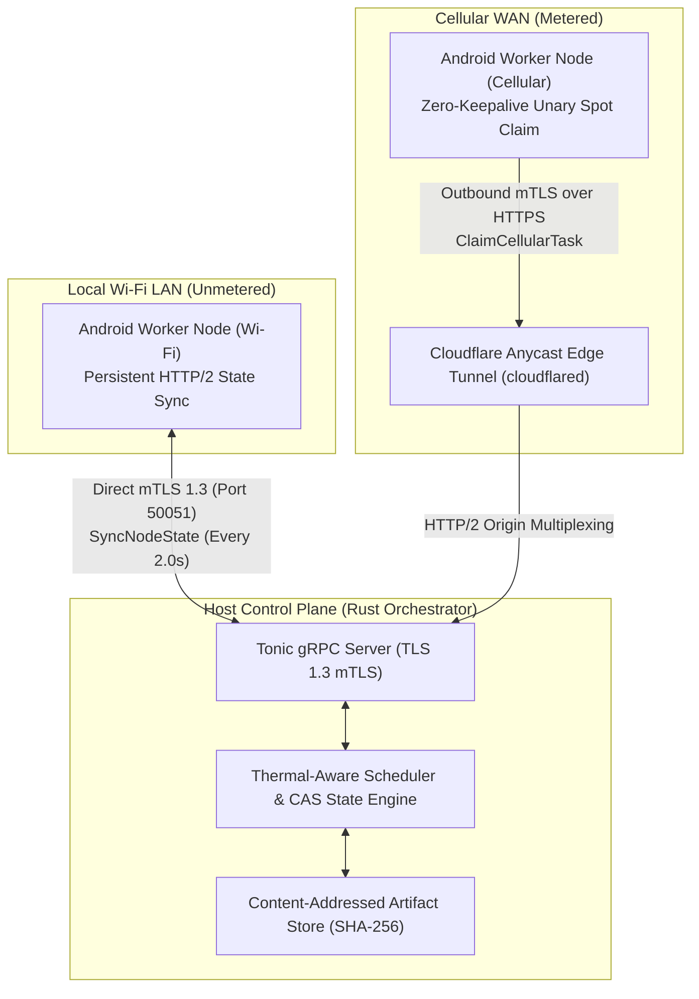

# System Overview and Master Architecture

The **AndroGrid Control Plane** is a distributed coordination platform developed in Rust, engineered to harness heterogeneous Android mobile devices as edge-compute workers while operating under stringent physical constraints: power preservation, thermal boundaries, and network variability.

Traceability: `[REQ-OP-001]`, `[REQ-OP-002]`, `[REQ-OP-003]`, `[REQ-OP-004]`, `[INV-001]`, `[INV-002]`, `[INV-003]`, `[INV-004]`, `[INV-005]`, `[INV-006]`.

---

## Dual-Route Architecture: Wi-Fi LAN vs Cellular WAN

The cluster divides network operations into two distinct interaction planes:



### 1. Wi-Fi Persistent Declarative Surface (Unmetered LAN)
- **High-Bandwidth, Low-Latency:** When worker nodes are connected via local Wi-Fi, they communicate directly with the orchestrator without proxy overhead.
- **Node Registration (`[REQ-OP-001]`):** Nodes submit hardware metrics (CPU cores, RAM, ABI, root state, thermal status). The orchestrator validates capabilities and grants a lease session.
- **Declarative Synchronization (`[REQ-OP-002]`):** Workers execute a periodic 2.0-second synchronization loop (`SyncNodeState`), reporting execution states and receiving desired task specs.

### 2. Cellular Disconnected Unary Surface (Metered WAN)
- **Outbound-Only Ingress (`[INV-001]`):** Cellular workers never listen on server ports. All requests originate outbound.
- **Zero-Keepalive Unary Leases (`[INV-003]`, `[NFR-POW-001]`):** Cellular devices do not maintain persistent streams or heartbeats. A worker invokes `ClaimCellularTask` as a single unary RPC and immediately terminates the TCP socket within 200 ms to return the cellular modem to low-power Radio Resource Control (RRC) sleep.
- **Spot Lease Cap (`[INV-005]`):** Tasks claimed over cellular WAN are granted with a strict execution deadline capped at 180 seconds.

---

## Monotonic Consensus and Compare-And-Swap (CAS) Engine

In distributed mobile edge computing, workers experience latency spikes, radio drops, and spot preemption. To prevent double-commit races and stale execution commits, AndroGrid implements **Monotonic Attempt Fencing** (`[INV-004]`).

```mermaid
sequenceDiagram
    autonumber
    participant Orch as Host Orchestrator (CAS Engine)
    participant Cell as Cellular Worker (Attempt 1)
    participant WiFi as Wi-Fi Worker (Attempt 2)

    Note over Cell,Orch: Cellular Worker claims task
    Cell->>Orch: ClaimCellularTaskRequest (Node A)
    Orch-->>Cell: ClaimCellularTaskResponse (Task X, run_attempt=1)
    Note over Cell: Socket closed within 200ms (RRC Sleep)
    Note over Cell: Executing WASM payload...

    Note over Orch,WiFi: Wi-Fi worker connects; Orchestrator speculatively preempts
    WiFi->>Orch: SyncNodeStateRequest (Node B)
    Orch-->>WiFi: SyncNodeStateResponse (Task X, run_attempt=2)
    Note over WiFi: Executing WASM payload...

    Note over Cell,Orch: Cellular worker finishes first
    Cell->>Orch: SubmitCellularResultRequest (Task X, run_attempt=1)
    Orch->>Orch: CAS update state: RUNNING -> COMPLETED
    Orch-->>Cell: SubmitCellularResultResponse (accepted=true)

    Note over WiFi,Orch: Wi-Fi worker finishes later
    WiFi->>Orch: SyncNodeStateRequest (Task X completed, run_attempt=2)
    Orch->>Orch: Verify attempt: Task X already finalized
    Orch-->>WiFi: SyncNodeStateResponse (acknowledged=Task X, dropped)
```

### Speculative Dual-Assignment Rules
1. Every task holds a monotonic `run_attempt` counter starting at 1.
2. If a cellular worker holds a lease on Task X (`run_attempt = 1`), and an unmetered Wi-Fi worker connects, the orchestrator may speculatively assign Task X to the Wi-Fi node with `run_attempt = 2`.
3. Whichever worker returns a valid result first executes an atomic Compare-And-Swap transition from `RUNNING` to `COMPLETED`.
4. Subsequent submissions bearing a stale or already finalized attempt counter are rejected with `TASK_ATTEMPT_STALE`, guaranteeing zero duplicate results (`[NFR-REL-001]`).

---

## WebAssembly and WASI Execution Boundary

To ensure safe computation across unrooted consumer devices:
- **Sandbox Isolation Boundary (`[INV-006]`):** Unrooted devices are strictly restricted to WebAssembly execution (`EXECUTION_ENGINE_WASM_WASI`). Shell execution (`EXECUTION_ENGINE_ROOT_SHELL`) is never assigned to unrooted workers.
- **In-Memory W^X Security (`[REQ-VER-003]`):** Android 10+ devices prohibit executing shared objects from writable app storage. Bytecode compilation takes place exclusively in memory via `memfd_create` or interpreter fallback.
- **Decoupled Artifact Distribution:** WebAssembly bytecode is distributed via content-addressed SHA-256 URLs, reducing unary gRPC metadata to under 4 KB and preserving cellular radio sleep deadlines (`[NFR-POW-001]`).
