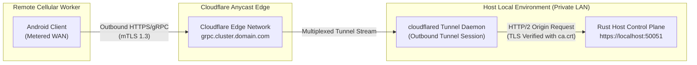

# Cloudflare Anycast Ingress Deployment Guide

This guide details configuring **Cloudflare Tunnel (`cloudflared`)** for AndroGrid cellular worker ingress. This architecture enables remote Android worker nodes on metered cellular WAN networks to connect to the host control plane without public static IPs or router port-forwarding rules.

Traceability: `[ANTI-002]`, `[REQ-OP-003]`, `[INV-001]`, `[INV-002]`, `[NFR-SEC-001]`.

---

## Architectural Context and Anti-Requirement Compliance

Traditional self-hosted edge clusters require operators to configure dynamic DNS, public static IP addresses, or router NAT port-forwarding. In AndroGrid:

- **[ANTI-002] Anti-Requirement:** The deployment architecture shall not require router port-forwarding rules, public static IP addresses, or third-party client VPN configuration on the host infrastructure.
- **[INV-001] Outbound Ingress:** The `cloudflared` daemon creates an outbound-only QUIC/HTTP2 tunnel connection to Cloudflare Anycast edge servers.
- **End-to-End Encryption:** Client certificates and TLS 1.3 mTLS are terminated directly at the host control plane, preventing unauthenticated edge ingress.



---

## Step-by-Step Setup

### Step 1: Install and Authenticate `cloudflared`

Install the `cloudflared` binary on the host machine or use the provided Docker image:

```bash
# Authenticate cloudflared with your Cloudflare account
cloudflared tunnel login
```

This generates an authorization certificate in `~/.cloudflared/cert.pem`.

---

### Step 2: Create an Ingress Tunnel

Create a named tunnel for the cluster:

```bash
cloudflared tunnel create androgrid-control-plane
```

Take note of the returned Tunnel UUID. A credentials file is created at:
`~/.cloudflared/<TUNNEL_UUID>.json`.

Copy this credentials file into the `deploy/` directory:
```bash
cp ~/.cloudflared/<TUNNEL_UUID>.json ./deploy/credentials.json
```

---

### Step 3: Route DNS to the Ingress Tunnel

Bind your chosen public gRPC hostname to the tunnel:

```bash
cloudflared tunnel route dns androgrid-control-plane grpc.cluster.domain.com
```

---

### Step 4: Configure `cloudflared.yml`

Copy the configuration template from `deploy/ingress/cloudflared-template.yml` to `deploy/ingress/cloudflared.yml`:

```yaml
tunnel: <REPLACE_WITH_TUNNEL_UUID>
credentials-file: /etc/cloudflared/credentials.json

ingress:
  # Route gRPC WAN traffic to local Rust orchestrator control plane
  - hostname: grpc.cluster.domain.com
    service: https://orchestrator:50051
    originRequest:
      http2Origin: true
      noTLSVerify: false
      caPool: /etc/cloudflared/ca.crt

  # Default catch-all service returns HTTP 404 for unmatched hostnames
  - service: http_status:404
```

Key configuration parameters:
- `http2Origin: true`: Mandatory for gRPC multiplexing.
- `noTLSVerify: false`: Enforces certificate validation against the local Root CA (`ca.crt`).
- `caPool: /etc/cloudflared/ca.crt`: Internal Root CA certificate ensuring trusted origin communication.

---

### Step 5: Launch Ingress via Docker Compose

In `deploy/docker-compose.yml`, the `cloudflared` service is configured as a companion container:

```bash
cd deploy
docker compose up -d cloudflared
```

Inspect tunnel logs to confirm established edge connections:

```bash
docker compose logs -f cloudflared
```

Expected log output:
```text
INF Connection registered with Cloudflare edge location: ORD
INF Connection registered with Cloudflare edge location: IAD
```

---

## Verification

Test the ingress tunnel from a remote network using `androgrid-cli`:

```bash
androgrid-cli \
  --endpoint https://grpc.cluster.domain.com \
  --ca-cert ./deploy/pki/ca.crt \
  --client-cert ./deploy/pki/client.crt \
  --client-key ./deploy/pki/client.key \
  nodes
```

The request traverses the Cloudflare Anycast edge, forwards through the tunnel, mutually authenticates via TLS 1.3, and returns the cluster node inventory.
