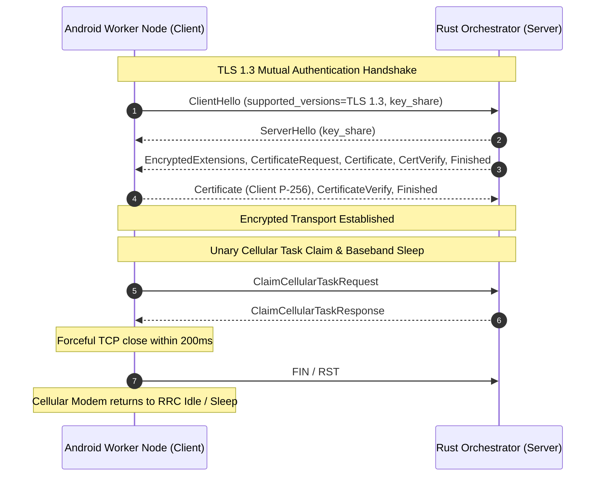

# Security and PKI Architecture

The AndroGrid security architecture is engineered around the principle of zero trust across untrusted networks: every connection requires mutual cryptographic authentication, mobile sandboxes are strictly bounded, and baseband cellular modems are protected against battery drain.

Traceability: `[INV-002]`, `[INV-003]`, `[INV-006]`, `[NFR-SEC-001]`, `[NFR-POW-001]`, `[REQ-VER-003]`.

---

## Mutual TLS 1.3 (mTLS) Transport Security

All communications between mobile worker nodes, operator CLI tools, and the host control plane are encrypted and mutually authenticated using internal X.509 v3 certificates conforming strictly to TLS 1.3 (`[INV-002]`, `[NFR-SEC-001]`).

### Cipher Suites and Key Parameters
- **Asymmetric Curve:** ECDSA NIST P-256 (`prime256v1`).
- **Signature Algorithm:** `ECDSA-SHA256`.
- **Enforced TLS 1.3 Cipher Suites:** `TLS_AES_128_GCM_SHA256` and `TLS_AES_256_GCM_SHA384`.
- **Zero TLS 1.2 Fallback:** Older TLS versions, RSA cipher suites, and unencrypted HTTP connections are rejected at the transport boundary.



---

## Certificate Hierarchy and Roles

The cluster PKI consists of three distinct certificate roles:

```text
+-------------------------------------------------------+
|              Internal Root CA (ca.crt)               |
|            Validity: 5 Years (1825 Days)              |
+-------------------------------------------------------+
                           |
          +----------------+----------------+
          |                                 |
+-----------------------+       +-----------------------+
|  Host Orchestrator    |       | Android Worker Client |
|   Server Certificate  |       |   Node Certificate    |
|     (server.crt)      |       |     (client.crt)      |
|  SAN: localhost, IP   |       |   PKCS12 (.p12) Store |
|  Validity: 2 Years    |       |   Validity: 1 Year    |
+-----------------------+       +-----------------------+
```

### 1. Internal Root CA (`ca.crt`)
- Self-signed X.509 v3 root authority.
- Configured as the sole trust anchor for the Rust orchestrator and worker Android keystore.

### 2. Orchestrator Server Certificate (`server.crt`)
- Issued with Subject Alternative Names (SANs) for cluster domains (`localhost`, `127.0.0.1`, `grpc.cluster.domain.com`).
- Bound to the Tonic gRPC server via `rustls`.

### 3. Worker Node Client Certificate (`client.crt`)
- Unique client certificate representing the mobile worker identity.
- Packaged as a password-protected PKCS12 archive (`client.p12`) imported into the Android KeyStore during provisioning.

---

## Cellular Baseband Radio Efficiency & RRC Sleep

Cellular modems consume significant power when remaining in active Radio Resource Control (RRC) connected states:

- **Active State (High Power):** Continuous reception and transmission consuming hundreds of milliwatts.
- **RRC Inactivity Tail (Medium Power):** Modems remain in an intermediate tail state for 10 to 15 seconds after packet transmission before dropping to idle.
- **RRC Idle / Sleep (Low Power):** Power consumption drops below 5 mW.

### Zero-Keepalive Enforcement (`[INV-003]`, `[NFR-POW-001]`)
To eliminate radio tail battery drain:
1. No persistent streaming RPCs or ping heartbeats are permitted over cellular WAN (`[ANTI-001]`).
2. Upon receiving `ClaimCellularTaskResponse`, the worker must terminate the HTTP/2 channel and TCP socket within **200 ms**.
3. Dropping the connection enables the baseband radio to enter low-power sleep immediately while task computation runs locally in the background.

---

## In-Memory W^X Sandbox Isolation

To safeguard consumer Android devices:
- **Sandbox Boundary (`[INV-006]`):** Unrooted workers are strictly constrained to WebAssembly execution (`EXECUTION_ENGINE_WASM_WASI`).
- **Memory Protection (`[REQ-VER-003]`):** Android 10+ (API 29+) enforces W^X (Write XOR Execute) memory policies on application directories. Wasm bytecode execution uses in-memory compilation via `memfd_create` or interpreter execution, never writing shared object binaries (`.so`) to flash storage.
