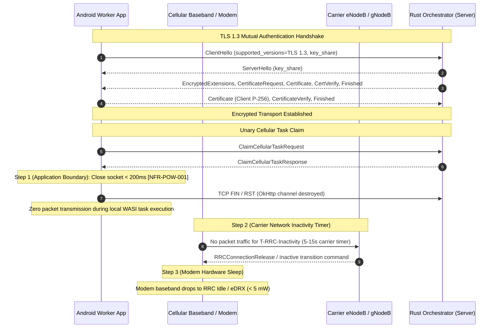

# Security and PKI Architecture

The AndroGrid security architecture is engineered around the principle of zero trust across untrusted networks: every connection requires mutual cryptographic authentication, mobile sandboxes are strictly bounded, and baseband cellular modems are protected against battery drain.

Traceability: `[INV-002]`, `[INV-003]`, `[INV-006]`, `[NFR-SEC-001]`, `[NFR-POW-001]`, `[REQ-VER-003]`.

---

## Mutual TLS 1.3 (mTLS) Transport Security

All communications between mobile worker nodes, operator CLI tools, and the host control plane are encrypted and mutually authenticated using internal X.509 v3 certificates conforming strictly to TLS 1.3 (`[INV-002]`, `[NFR-SEC-001]`).

### Cipher Suites and Key Parameters
- **Asymmetric Curve:** ECDSA NIST P-256 (`prime256v1`).
- **Signature Algorithm:** `ECDSA-SHA256`.
- **Enforced TLS 1.3 Cipher Suites:** `TLS_AES_128_GCM_SHA256` and `TLS_AES_256_GCM_SHA384`.
- **Zero TLS 1.2 Fallback:** Older TLS versions, RSA cipher suites, and unencrypted HTTP connections are rejected at the transport boundary.



---

## Certificate Hierarchy and Roles

The cluster PKI consists of three distinct certificate roles:

```text
+-------------------------------------------------------+
|              Internal Root CA (ca.crt)               |
|            Validity: 5 Years (1825 Days)              |
+-------------------------------------------------------+
                           |
          +----------------+----------------+
          |                                 |
+-----------------------+       +-----------------------+
|  Host Orchestrator    |       | Android Worker Client |
|   Server Certificate  |       |   Node Certificate    |
|     (server.crt)      |       |     (client.crt)      |
|  SAN: localhost, IP   |       |   PKCS12 (.p12) Store |
|  Validity: 2 Years    |       |   Validity: 1 Year    |
+-----------------------+       +-----------------------+
```

### 1. Internal Root CA (`ca.crt`)
- Self-signed X.509 v3 root authority.
- Configured as the sole trust anchor for the Rust orchestrator and worker Android keystore.

### 2. Orchestrator Server Certificate (`server.crt`)
- Issued with Subject Alternative Names (SANs) for cluster domains (`localhost`, `127.0.0.1`, `grpc.cluster.domain.com`).
- Bound to the Tonic gRPC server via `rustls`.

### 3. Worker Node Client Certificate (`client.crt`)
- Unique client certificate representing the mobile worker identity.
- Packaged as a password-protected PKCS12 archive (`client.p12`) imported into the Android KeyStore during provisioning.

---

## Cellular Baseband Radio Efficiency & RRC Sleep

Cellular modems consume significant power when remaining in active Radio Resource Control (RRC) connected states:

- **Active State (High Power, ~1000-2000 mW):** Active data transmission and reception.
- **RRC Inactivity Tail State (Medium Power, ~400-600 mW):** Following packet transmission, the cellular baseband radio remains in an intermediate tail state while the carrier network's inactivity timer elapses (typically 5 to 15 seconds, configured by carrier eNodeB/gNodeB parameters).
- **RRC Idle / Discontinuous Reception (Low Power, < 5 mW):** Once the carrier inactivity timer expires without further packet transmission, the radio modem enters low-power RRC Idle / eDRX sleep.

### Application Socket Teardown vs Modem RRC Sleep Boundary

It is vital to distinguish application-level socket management from physical modem state transitions:
1. **Application Action (`[NFR-POW-001]`):** The Android worker application controls the application and transport layers. Upon receiving `ClaimCellularTaskResponse`, the worker must forcibly terminate the gRPC HTTP/2 channel and TCP socket within **200 ms**.
2. **Modem and Network Governance:** The mobile application cannot directly command the baseband modem firmware into RRC Idle; RRC state transitions are strictly controlled by the cellular modem and carrier network (eNodeB / gNodeB) timers.
3. **The Zero-Keepalive Rationale (`[INV-003]`, `[ANTI-001]`):** If the application were to maintain a persistent streaming connection or emit periodic heartbeat packets (common in gRPC streams), each keepalive packet would reset the carrier's 10-15s inactivity timer, locking the baseband radio into the high-power tail state indefinitely. Immediate socket closure (< 200 ms) guarantees zero packet traffic during local WASI task execution, allowing the carrier inactivity timer to expire promptly and enabling the modem to drop into low-power RRC Idle sleep.

---

## In-Memory W^X Sandbox Isolation

To safeguard consumer Android devices:
- **Sandbox Boundary (`[INV-006]`):** Unrooted workers are strictly constrained to WebAssembly execution (`EXECUTION_ENGINE_WASM_WASI`). Shell execution (`EXECUTION_ENGINE_ROOT_SHELL`) is never assigned to unrooted workers.
- **Pure-JVM Memory Protection (`[REQ-VER-003]`):** Android 10+ (API 29+) enforces W^X (Write XOR Execute) memory policies on application directories. The Android worker embeds Chicory, a zero-dependency pure-JVM WebAssembly and WASI Preview 1 interpreter. Bytecode execution operates entirely in-memory within standard JVM heap allocations without emitting native `.so` files to flash storage or requesting executable memory mappings.
