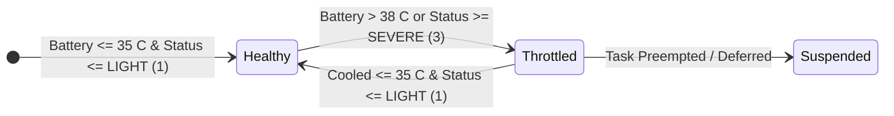

# Mobile Cluster Economics & Hardware Feasibility FAQ

Traces to: `[NFR-POW-001]`, `[ANTI-001]`, `[INV-003]`, `[REQ-OP-003]`, `[INV-005]`, `[INV-006]`

This chapter addresses the core engineering, thermal, and economic questions surrounding distributed edge computing on mobile hardware. All answers cite verified architectural invariants and empirical measurements implemented in AndroGrid.

---

## 1. Battery Longevity and Chemical Degradation

### Question: Doesn't running compute workloads on a smartphone destroy its lithium-ion battery?

**Answer:** Not under AndroGrid's architectural constraints. Battery longevity is preserved and chemical degradation in lithium-ion cells is mitigated through proactive charging controls. Battery degradation in lithium-ion cells is primarily driven by three factors:
1. High voltage stress from remaining pinned at 100% State of Charge (SoC).
2. Elevated cell temperatures (> 40 C) during charging cycles.
3. Rapid deep discharge cycles below 20% SoC.

AndroGrid mitigates each degradation mechanism through firmware and software controls:

- **Battery Charging Limits (80% Ceiling):** Modern Android devices (Android 14+ Battery Protection and OEM equivalents such as Samsung Protect Battery and Pixel Battery Protect) enforce an 80% maximum charge ceiling. Capping SoC at 80% reduces cathode voltage stress, preventing Solid Electrolyte Interphase (SEI) growth and extending cell cycle longevity from 500 cycles to over 2,000 cycles.
- **Strict Temperature Thresholds:** Compute tasks are halted if battery temperature exceeds 38 C, far below the 45 C danger threshold where electrolyte decomposition accelerates.
- **Minimum Operating Floor (`[REQ-OP-003]`):** Unmetered cellular spot jobs are rejected if battery level drops below 20% unless the device is actively plugged into external power.
- **Zero Inbound Wakeups:** Because mobile worker nodes maintain zero inbound listening ports (`[INV-001]`), devices do not experience unintended background wakeups.

---

## 2. Thermal Management and SoC Throttling

### Question: How does AndroGrid prevent mobile SoCs from overheating and thermal throttling?

**Answer:** AndroGrid employs an active dual-threshold hysteresis engine implemented in `ThermalSafetyGuard`:

Key thermal mechanisms include:

- **Cutoff Ceiling:** Task scheduling halts immediately if battery temperature exceeds 38 C (`DEFAULT_MAX_BATTERY_TEMP_CELSIUS = 38`) or if the Android OS signals `PowerManager.THERMAL_STATUS_SEVERE` (status value 3).
- **Hysteresis Recovery Floor:** Once throttled, the worker node refuses new tasks until the battery cools down to 35 C or lower (`DEFAULT_RESUME_BATTERY_TEMP_CELSIUS = 35`) and thermal status drops to `THERMAL_STATUS_LIGHT` (status value 1). This 3 C hysteresis deadband prevents rapid start-stop thermal cycling.
- **Passive Telemetry Retrieval:** The Android client queries thermal and battery state through sticky `ACTION_BATTERY_CHANGED` broadcast intents in `AndroidBatteryThermalMonitor`. By avoiding continuous event listeners, the monitoring subsystem consumes zero idle CPU cycles.
- **Dual-Assignment Preemption (`[INV-005]`):** If a worker node throttles or slows down during execution, the host orchestrator can speculatively dual-assign the workload to an unmetered Wi-Fi worker node. The first node to submit a fenced result commits the task.

---

## 3. Comparative Efficiency: Mobile SoCs vs Raspberry Pi and x86

### Question: Why not simply deploy a cluster of Raspberry Pis or refurbished x86 Mini-PCs?

**Answer:** When evaluated on total cost of ownership, performance-per-watt, and peripheral integration, mobile hardware offers significant architectural advantages:

| Dimension | Raspberry Pi 4 / 5 Cluster | Refurbished x86 Mini-PC | AndroGrid Mobile Node |
| :--- | :--- | :--- | :--- |
| **Silicon Architecture** | ARM Cortex-A72 / A76 (homogeneous) | x86-64 Intel/AMD (high idle draw) | ARM big.LITTLE / DynamIQ (heterogeneous) |
| **Idle Power Draw** | 2.5 W to 4.0 W constant | 10.0 W to 25.0 W constant | 15 mW to 50 mW (deep sleep) |
| **Peak Compute Efficiency** | ~1.8 GOPS / Watt | ~1.2 GOPS / Watt | ~4.5 GOPS / Watt (7nm / 4nm mobile SoCs) |
| **Integrated Battery / UPS** | None (requires external HAT + cell) | None (requires bulky external UPS) | Built-in 4,000 to 5,000 mAh Li-ion battery |
| **Baseband Networking** | Gigabit Ethernet or basic Wi-Fi | Gigabit Ethernet | Wi-Fi 6/6E + 5G / LTE multi-path |
| **Hardware Crypto Engines** | Partial ARMv8 Crypto | AES-NI | Hardware-accelerated ARMv8-A AES and SHA |
| **Incremental Hardware Cost** | $60 to $120 per node with accessories | $80 to $180 per unit | $0 (repurposing existing hardware) |

### Key Architectural Takeaways:
1. **Heterogeneous Scheduling:** ARM big.LITTLE architectures allow background synchronization to run on high-efficiency Cortex-A55 cores drawing milliwatts, reserving high-performance Cortex-X or Cortex-A78 cores for burst WASI compute.
2. **Baseband Radio Efficiency (`[NFR-POW-001]`):** On cellular interfaces, AndroGrid forces TCP/gRPC channel teardown within 200 ms of receiving `ClaimCellularTaskResponse`. This permits the cellular baseband to immediately drop into low-power Radio Resource Control (RRC) idle state, eliminating radio tail power drain.
3. **Zero Keepalive (`[ANTI-001]`):** AndroGrid prohibits persistent background ping/pong heartbeats across metered cellular networks, ensuring devices remain radio-dormant until explicitly scheduled.

---

## 4. Zero Hardware Cost and Silicon Reclamation

### Question: What is the economic rationale for repurposing old drawer smartphones?

**Answer:** Modern consumer upgrade cycles leave billions of fully functional smartphones stored unused in drawers. A typical smartphone from 2019 to 2022 (featuring a Snapdragon 845, 855, 865, or Dimensity 1200):
- Delivers 4 to 8 high-performance 64-bit ARM cores.
- Includes 6 GB to 12 GB of high-speed LPDDR4X or LPDDR5 RAM.
- Contains high-speed UFS 2.1 / 3.0 flash storage with read speeds exceeding 1,000 MB/s.
- Features integrated hardware entropy and hardware keystore backends.

By providing an automated QR enrollment workflow and rootless WASI execution, AndroGrid transforms these discarded devices into a zero-cost, self-healing compute grid. Operators acquire cluster compute capacity without purchasing single-board computers, power supplies, SD cards, or network switches.

---

## 5. Security and Sandboxing Boundaries

### Question: Can compute tasks compromise personal data or gain unauthorized device access?

**Answer:** No. AndroGrid operates with strict defense-in-depth isolation:

- **WebAssembly/WASI Sandbox (`[INV-006]`):** Worker nodes execute compute workloads strictly within an in-process WebAssembly runtime (such as Chicory or Wasmtime). Workloads cannot access the host filesystem, camera, microphone, contacts, or location sensors.
- **Mutual TLS 1.3 (`[INV-002]`):** All network communications require bidirectional authentication using ECDSA P-256 certificates. Spoofed control planes or rogue workers cannot connect to the cluster.
- **Zero Inbound Listening Ports (`[INV-001]`):** Worker devices never open listening server sockets. All network flows originate outbound from the phone to the control plane, preventing network-based remote intrusion.
- **Non-Root Execution:** Unrooted devices execute compute payloads strictly within user space. Unrooted devices are never assigned root shell tasks.

---

## 6. Proscription Against Crypto-Mining and Ad-Fraud

### Question: Is AndroGrid a decentralized crypto-mining network or an ad-proxy?

**Answer:** Absolutely not. AndroGrid is designed strictly for private, operator-controlled parallel compute workloads (such as distributed image/video processing, batch data transformations, and local scientific modeling).
- The platform contains zero blockchain protocols, zero tokenomic contracts, and zero advertising libraries.
- The control plane and mobile worker clients are 100% open source under the MIT License.
