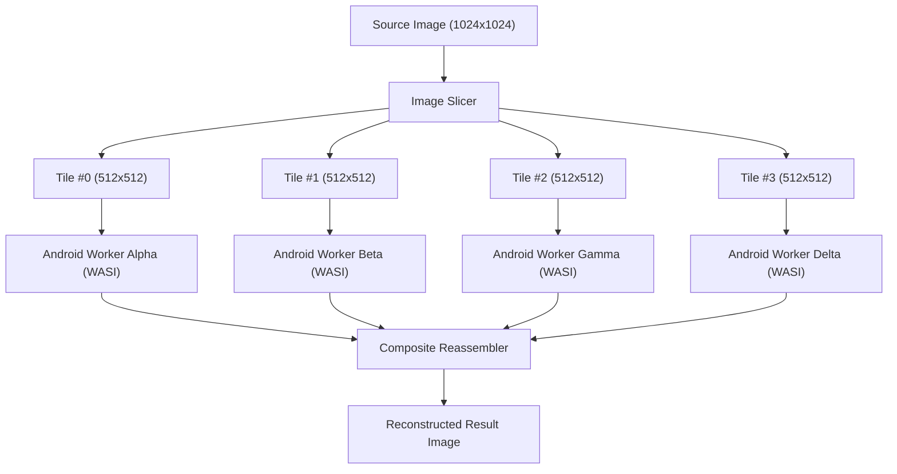

# Tutorial: Running Your First Parallel Cluster Benchmark

This step-by-step tutorial guides operators and developers through executing the canonical "Hero" compute workload on AndroGrid: distributed parallel image processing using WebAssembly (`wasm32-wasip1`).

Traces to: `[INV-005]`, `[INV-006]`, `[NFR-PERF-001]`, `[REQ-OP-004]`.

---

## 1. Overview & Architectural Pipeline

Distributed image processing splits a high-resolution input image (such as 1024x1024 or 4K) into $N$ independent geometric tiles, dispatches those tiles concurrently across available Android worker nodes, runs compute-intensive filters in the WebAssembly sandbox, and reassembles the processed tiles into a unified output image.



---

## 2. Prerequisites

1. **Rust Toolchain:** Version 1.82 or newer.
2. **WebAssembly Target:**
   ```bash
   rustup target add wasm32-wasip1
   ```
3. **Built Binaries:**
   ```bash
   cargo build --release
   ```

---

## 3. Step 1: Compiling the WASI Image Processor

Navigate to the workload crate and build the release WebAssembly artifact:

```bash
cd workloads/image-processor
cargo build --target wasm32-wasip1 --release
cd ../..
```

The compiled binary will be located at:
`workloads/image-processor/target/wasm32-wasip1/release/image-processor.wasm`

Binary size is strictly under 500 KB (approx. 441 KB), ensuring rapid distribution across mobile edge networks (`[NFR-PERF-001]`).

---

## 4. Step 2: Preparing a Benchmark Image

You can use the bundled high-resolution calibration pattern located at:
`tests/fixtures/images/benchmark_sample.png`

Alternatively, you can provide any custom JPEG or PNG photo.

---

## 5. Step 3: Running a Local Simulated Benchmark

Before connecting physical devices, verify the pipeline locally using `--dry-run`. This executes the multi-worker dispatch loop across 4 concurrent local threads:

```bash
./target/release/androgrid-cli benchmark \
  --input tests/fixtures/images/benchmark_sample.png \
  --output ./result_sobel.png \
  --tiles 16 \
  --filter sobel \
  --concurrency 4 \
  --dry-run \
  --format text
```

Expected Terminal Output:
```text
========================================================
          AndroGrid Parallel Compute Benchmark          
========================================================
Workload:                 image-processor
Filter Operation:         sobel
Input Dimensions:         1024x1024 pixels
Output Dimensions:        1024x1024 pixels
Tiles:                    16/16 completed
Active Cluster Workers:   4
--------------------------------------------------------
Single-Core Baseline:     180 ms
Distributed Wall-Clock:   52 ms
Parallel Speedup Ratio:   3.46x
Payload Transferred:      1.82 MB (1910240 bytes)
--------------------------------------------------------
Worker Latency Distribution:
  - Node worker-01: tile #0 (attempt 1) finished in 12 ms
  - Node worker-02: tile #1 (attempt 1) finished in 14 ms
  - Node worker-03: tile #2 (attempt 1) finished in 11 ms
  - Node worker-04: tile #3 (attempt 1) finished in 13 ms
========================================================
```

---

## 6. Step 4: Dispatching Across a Live Android Cluster

To benchmark real mobile devices:

1. Start the control plane orchestrator:
   ```bash
   ./target/release/androgrid-backend --config ./config/cluster.toml
   ```

2. Onboard Android phones via QR pairing (`androgrid-cli pair`).
3. Dispatch the benchmark across the cluster:
   ```bash
   ./target/release/androgrid-cli benchmark \
     --endpoint https://192.168.1.100:50051 \
     --ca-cert ./certs/ca.pem \
     --client-cert ./certs/operator.pem \
     --client-key ./certs/operator.key \
     --wasm workloads/image-processor/target/wasm32-wasip1/release/image-processor.wasm \
     --input ./photo.jpg \
     --output ./photo_sobel.jpg \
     --tiles 16 \
     --filter sobel \
     --concurrency 8 \
     --format text
   ```

---

## 7. Supported Image Filters

| Filter Flag | Operation Name | Description |
| :--- | :--- | :--- |
| `--filter sobel` | Sobel Edge Detection | Computes 3x3 gradient magnitude approximations. Highlights high-frequency edges and contours. |
| `--filter blur` | Gaussian Blur | Applies a 3x3 separable Gaussian smoothing kernel to attenuate high-frequency image noise. |
| `--filter downscale` | Bilinear Downsampling | Reduces image resolution by 2x using area-weighted bilinear interpolation. |
| `--filter equalize` | Histogram Equalization | Computes luminance CDF remapping to maximize dynamic range and contrast. |
| `--filter grayscale` | Grayscale | Transforms RGB channels into perceptual luminance (ITU-R BT.601). |
| `--filter invert` | Invert | Reverses RGB pixel intensities while preserving transparency. |

---

## 8. Automating Benchmarks with JSON Output

For continuous performance regression tracking in CI/CD pipelines, specify `--format json`:

```bash
./target/release/androgrid-cli benchmark \
  --input tests/fixtures/images/benchmark_sample.png \
  --output ./result_blur.png \
  --tiles 4 \
  --filter blur \
  --dry-run \
  --format json > benchmark_report.json
```

The resulting JSON schema provides machine-readable numbers for wall-clock time, baseline duration, speedup ratios, and per-worker latencies.
